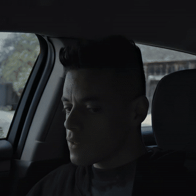
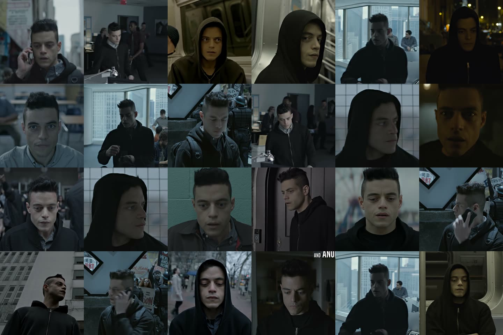

# Montazh — монтаж видео под музыку

Скилл и CLI, которые собирают ролик из папки с материалом: находят склейки в
исходниках, определяют темп и биты трека, раскладывают планы по сетке музыки и
рендерят готовый `mp4` со нормализованным звуком.

Без облаков, подписок и таймлайна в браузере: `python` + `numpy` + `ffmpeg`.



Так выглядит готовый ролик — 105 склеек на 144 BPM, сетка кадров каждые 2.5 c:



## Что умеет

- **Слышит ритм.** Спектральный поток → темп → ровная сетка битов и сильных долей.
  Живой трек с плавающим темпом переключается на DP-трекер.
- **Видит склейки.** Покадровая разница на уменьшенных кадрах находит границы
  планов и считает по каждому плану яркость, контраст, движение и резкость.
- **Монтирует по правилам.** Склейка = бит, длина плана = целое число битов,
  плотность планов повторяет энергию секций (куплет/припев/дроп).
- **Считает кадры, а не секунды.** Каждая склейка стоит на кадровой сетке,
  поэтому 100+ склеек не уводят видео от звука.
- **Рендерит параллельно**, кеширует сегменты, проверяет результат по числу кадров.
- **Отдаёт комплект:** `mp4` (H.264/AAC, faststart, −14 LUFS), постер, сетку кадров
  и текстовый отчёт с BPM и статистикой монтажа.

## Установка

Нужен `ffmpeg` и `python 3.10+` с `numpy`:

```bash
# Windows
winget install Gyan.FFmpeg
pip install numpy

# macOS
brew install ffmpeg && pip install numpy

# Debian/Ubuntu
sudo apt install ffmpeg && pip install numpy
```

Проверка:

```bash
python -m montazh doctor
```

В Windows можно без `python -m`: в папке скилла лежит `montazh.cmd`.

```powershell
C:\Users\<имя>\.dsh\skills\montazh\montazh.cmd doctor
```

## Быстрый старт

```bash
# положите клипы и трек в одну папку
python -m montazh preview --src "материал"          # черновик 20 c / 480p
python -m montazh variants --src "материал" --duration 30   # три стиля сразу
python -m montazh auto --src "материал" \
    --style dynamic --aspect 9:16 --duration 60 \
    --out out/montazh.mp4
```

| Ключ | Значение |
|---|---|
| `--src` | папка с клипами (видео/фото), можно вложенные |
| `--music` | явный путь к треку (иначе берётся самый длинный аудиофайл) |
| `--style` | `dynamic` \| `cinematic` \| `slideshow` |
| `--aspect` | `source` \| `1:1` \| `9:16` \| `16:9` \| `4:5` |
| `--duration` | длительность ролика, секунды |
| `--music-start` | с какой секунды трека начинать |
| `--fps`, `--height`, `--workers`, `--seed` | частота, высота кадра, потоки, повторяемость |

## Стили

| Стиль | Ритм | Переходы | Для чего |
|---|---|---|---|
| `dynamic` | склейка на бит/долю, 0.4–0.8 c | резкие каты, редкий панч-ин | клипы, Reels, Shorts |
| `cinematic` | такт–два, 1.5–3 c | наплыв 0.3 c, лёгкий зум | атмосферный ролик |
| `slideshow` | фраза, 3–4 c | наплыв 0.5 c, Ken Burns | фото и статика |

## Как это работает

```
папка → ffprobe (что внутри)
      → onset-анализ трека: BPM, биты, доли, секции
      → детект склеек: шоты + статистика кадра
      → планировщик: EDL (шот, in-point, скорость, зум, кадры)
      → параллельный рендер сегментов → сборка (cut/xfade) → звук (loudnorm)
```

Промежуточные артефакты — в `.montazh/`: `track.json`, `shots.json`, `plan.json`,
`report.json`. План можно править руками и рендерить заново — это обычный JSON.

```
.montazh/
  track.json      # BPM, биты, доли, секции
  shots.json      # все найденные планы с метриками
  plan.json       # EDL: что, откуда, сколько кадров
  report.json     # итог: файл, длительность, статистика
  render/run_<хэш>/segments_<хэш>/  # сегменты (кеш)
```

## Как поставить скиллом

Скилл — это папка с `SKILL.md` и кодом:

```powershell
# Windows
Copy-Item -Recurse . "$env:USERPROFILE\.dsh\skills\montazh"
```

```bash
# macOS / Linux
cp -r . ~/.dsh/skills/montazh
```

Дальше агент сам подхватит `montazh`, когда попросят «смонтировать под трек».

## Тесты

```bash
python -m unittest discover -s tests -v
```

Тесты генерируют синтетический материал (6 цветных планов + клик-трек на 120 BPM)
и проверяют весь путь: темп, ровность сетки, детект склеек, план, рендер,
совпадение числа кадров.

## Структура

```
SKILL.md               # инструкция скилла
montazh.cmd            # запуск в Windows одной командой
scripts/check_skill.py # проверка, что SKILL.md читается загрузчиком
montazh/
  cli.py               # команды: doctor / auto / analyze / preview / variants
  env.py               # поиск ffmpeg, запуск команд
  media.py             # ffprobe, сбор материалов из папки
  audio.py             # onset-поток, темп, биты, доли, секции
  shots.py             # детект склеек и метрики планов
  plan.py              # EDL: слоты по битам, выбор шотов, переходы
  render.py            # сегменты, сборка, звук, проверки
references/
  rhythm.md            # правила ритма и типичные ошибки
  ffmpeg-recipes.md    # ручные рецепты на все случаи
  troubleshooting.md   # что делать, когда сломалось
tests/test_pipeline.py
```

## Ограничения

- Если материала меньше, чем длительность ролика, планы повторяются — скилл
  честно пишет об этом в отчёте.
- Один длинный дубль без монтажных склеек даст мало шотов.
- Захардкоженные субтитры и логотипы остаются в кадре.
- Цветокоррекция не делается: только нормализация громкости.

## Лицензия

MIT — см. [LICENSE](LICENSE).
